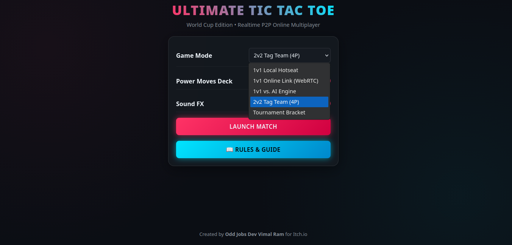
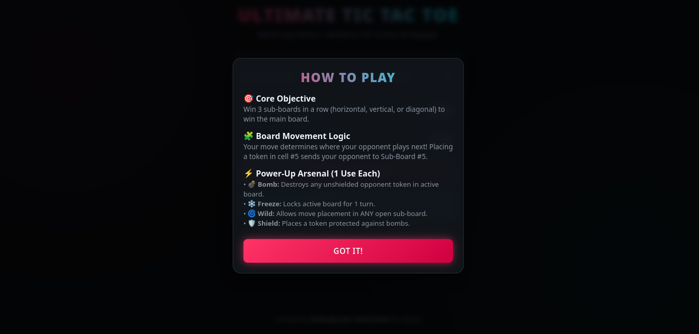
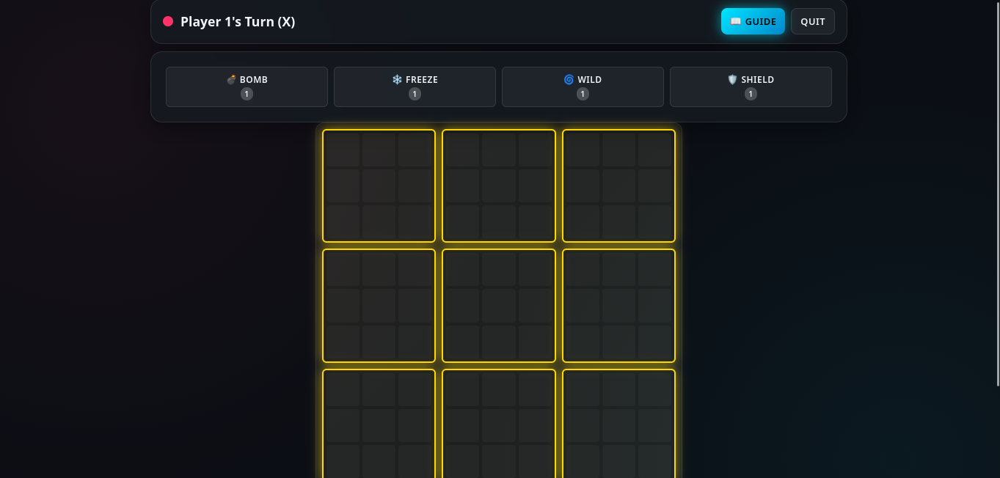
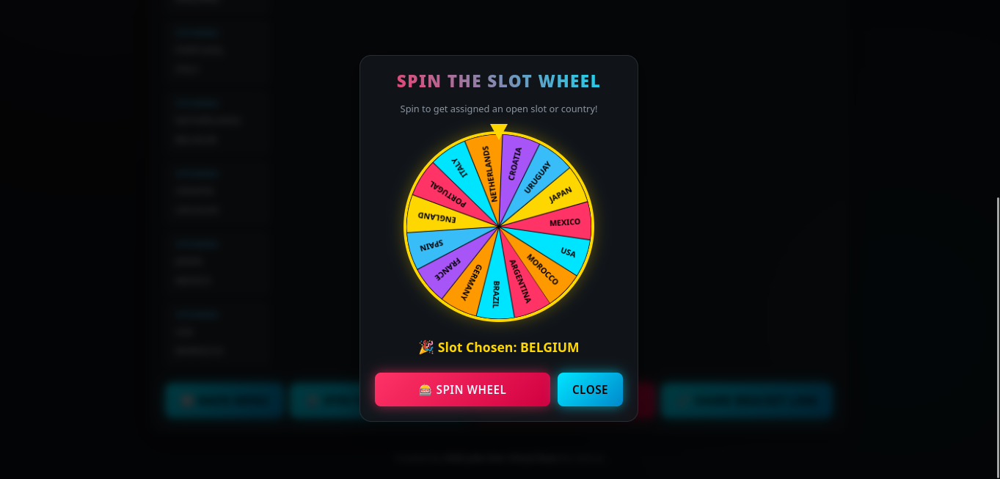

# 🏆 Ultimate Tic Tac Toe: World Cup & Online Edition

[](https://itch.io/embed-upload/18904951?color=333333)
[](LICENSE)
[](https://peerjs.com/)

A modern, web-based implementation of **Ultimate Tic Tac Toe** featuring a World Cup tournament engine, real-time WebRTC multiplayer, dynamic power-up decks, and slot allocation via an interactive wheel.

---

## 🎮 Play Live in Browser

[](https://itch.io/embed-upload/18904951?color=333333)

---

## 🕹️ Game Modes



- **1v1 Local Hotseat:** Two players take turns on the same screen.
- **1v1 Online Link (WebRTC):** Direct peer-to-peer room connections generated via link sharing without backend server dependencies.
- **1v1 vs. AI Engine:** Single-player challenge powered by an adaptive minimax decision engine.
- **2v2 Tag Team (4P):** Four players paired in teams, rotating turns dynamically within active sub-boards.
- **Tournament Bracket:** A 16-player knockout tournament system featuring country slot assignments and queue enforcement.

---

## 🎯 How to Play



### Core Objective

Win 3 adjacent sub-boards in a row (horizontal, vertical, or diagonal) to capture the overall main board.

### Board Movement Logic

Your move dictates where your opponent must play next. For example, placing a token in cell `#5` of any sub-board forces your opponent to make their next move inside **Sub-Board #5**.

---

## 🎮 Gameplay Mechanics



---

## ⚡ Power-Up Arsenal (1 Use Each)

| Power-Up   | Icon | Function                                                          |
| :--------- | :--: | :---------------------------------------------------------------- |
| **Bomb**   |  💣  | Destroys any unshielded opponent token in the active sub-board.   |
| **Freeze** |  ❄️  | Locks the target sub-board, preventing moves for 1 turn.          |
| **Wild**   |  🌀  | Grants freedom to place a mark in ANY open sub-board.             |
| **Shield** |  🛡️  | Places a token that is completely protected against bomb attacks. |

---

## 🎡 Spin the Slot Wheel



In **Tournament Mode**, slot distribution is handled via an interactive country selector:

1. Players open the **Slot Wheel** interface.
2. Spin the wheel to get assigned an open country or slot (e.g., Belgium, Brazil, Japan).
3. The assigned slot is locked to prevent double-spinning, and the match bracket updates automatically.

---

## 🚀 Quick Start & Local Setup

Since this game is built as a self-contained single-page web application, no heavy installation or `npm install` is required!

1. **Clone the repository**:

   ```bash
   git clone [https://github.com/Vimal9RAM-NAP/ultimate-tic-tac-toe.git](https://github.com/Vimal9RAM-NAP/ultimate-tic-tac-toe.git)
   cd ultimate-tic-tac-toe
   ```

2. **Run locally**:

- Open `index.html` directly in any web browser.
- Alternatively, run a local server for WebRTC multiplayer testing:

```bash
npx serve .
```

## 📜 How to Play Summary

1. Objective: Win 3 sub-boards in a row (horizontal, vertical, or diagonal) to win the main board.
2. Movement Rule: The cell index you pick in an active sub-board dictates which sub-board your opponent is forced to play on next.
3. Tournament Queue: In tournament mode, spin the wheel to claim your slot. Once assigned, wait for your bout to be active before entering the arena!

## 👤 Author & License

Developed by Odd Jobs Dev (Vimal Ram) for Itch.io.

## 📄 License

Distributed under the MIT License. See `LICENSE` for more information.
